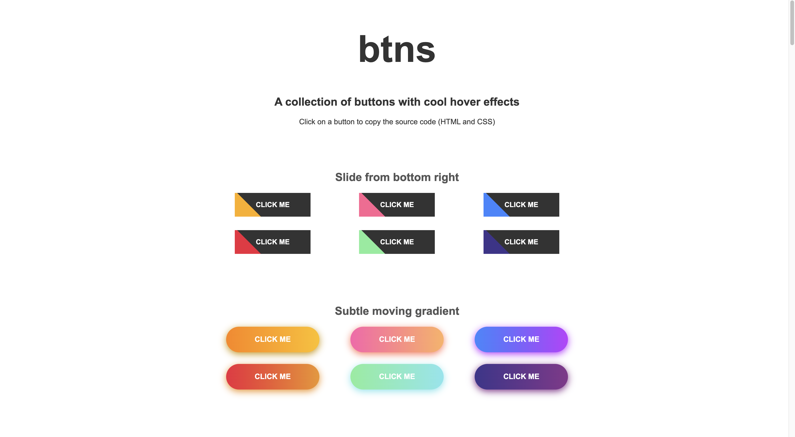
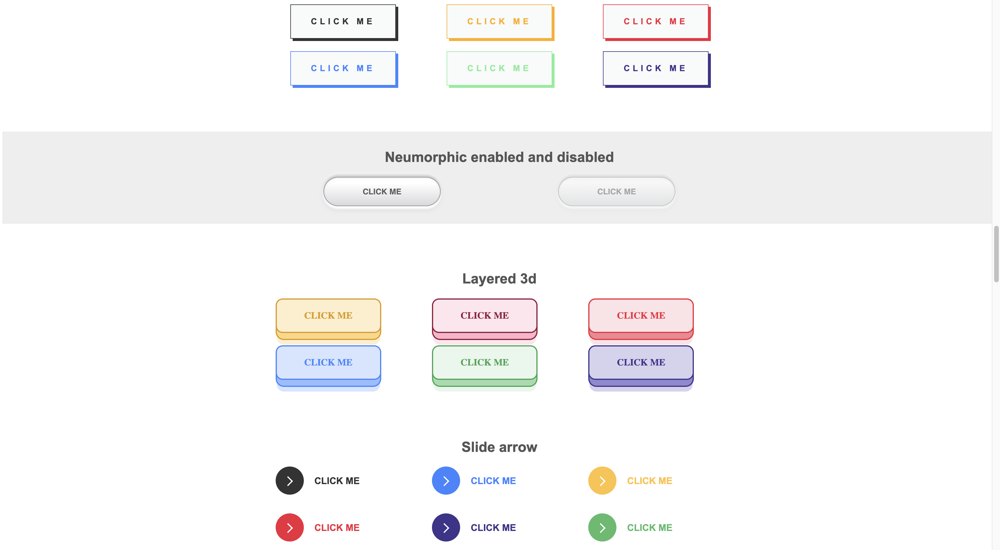

# btns
A collection of buttons with cool hover effects. 

When you hover over a button, you see a cool animation. Click on it to see a popup that lets you copy the button's code

Try it out: https://enjeck.com/btns/




## Run the project

```bash
git clone https://github.com/enjeck/btns.git
cd btns
npm install
npm run dev
```